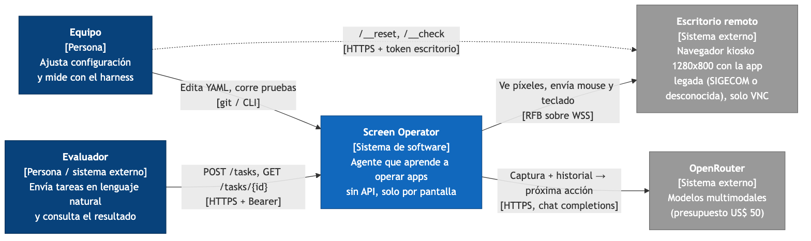
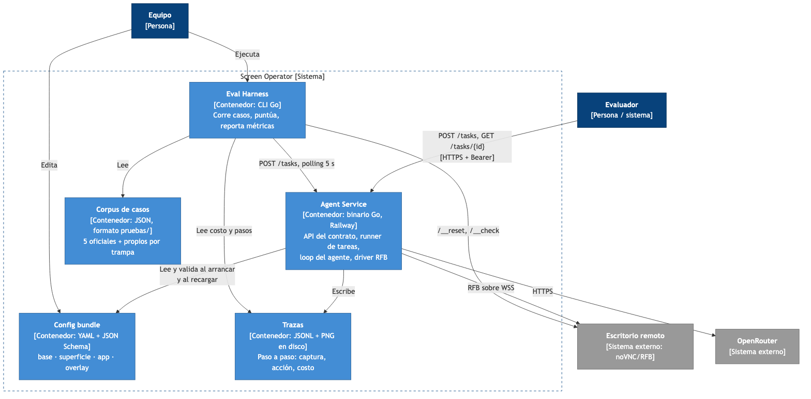
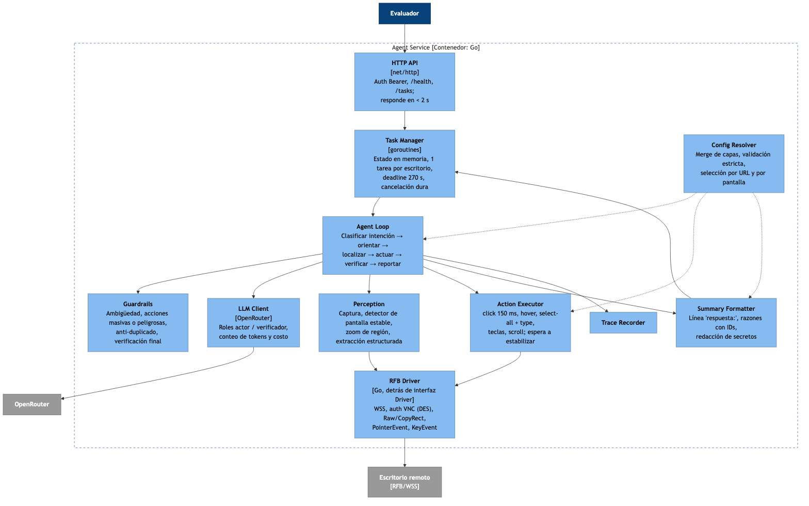
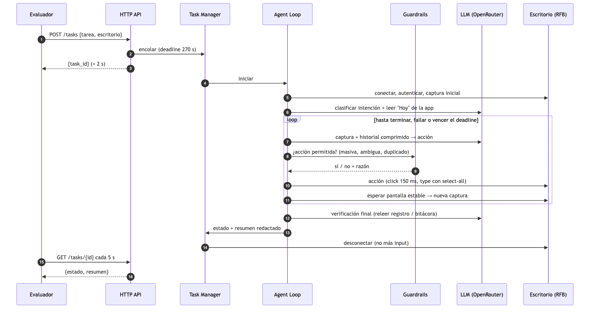

## Nivel 1 · Contexto

{width=100%}

## Nivel 2 · Contenedores

{width=100%}

\newpage

## Nivel 3 · Componentes del Agent Service

{width=100%}

\newpage

## Dinámico · Ciclo de vida de una tarea

{width=100%}

Convenciones C4: azul oscuro = persona, azul = sistema/contenedor propio, celeste = componente, gris = sistema externo.
