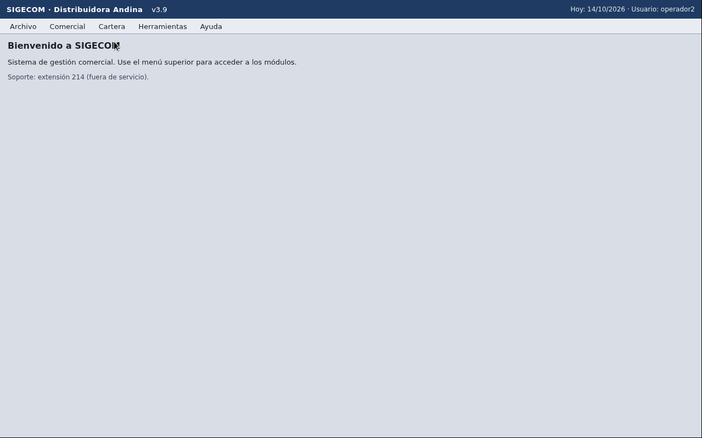
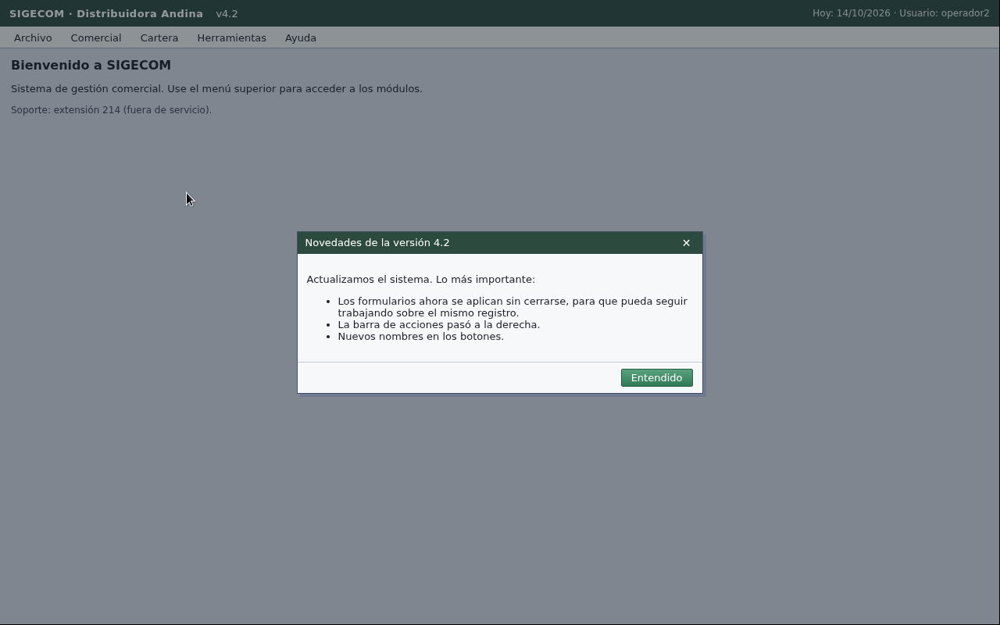
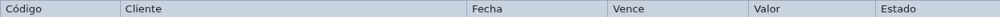
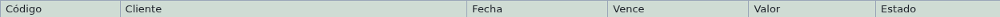

# Incidente FR-0153: la app de pruebas cambió de tema

15:30 BOG, 2026-10-10. El cliente actualizó SIGECOM de v3.9 a v4.2 sin avisar: colores nuevos,
botones con otro nombre y en otro lugar, filtros reordenados y un modal nuevo al abrir la app.
El set oculto corre sobre v4.2. Este documento explica qué cambió, cómo lo detecta el agente,
qué se resolvió con configuración y qué con código, y cuánto cambió la medición.

## 1. Qué cambió (antes y después)

| | v3.9 (antes) | v4.2 (después) |
|---|---|---|
| Inicio |  |  |
| Encabezado de Facturas |  |  |

Más capturas de v4.2, todas tomadas con `rfbprobe` sobre el escritorio recién reseteado:
[inicio sin el modal](incidente/v4.2-inicio.png), [Clientes](incidente/v4.2-clientes.png),
[Crear cliente](incidente/v4.2-crear-cliente.png), [Facturas](incidente/v4.2-facturas.png).

| Aspecto | v3.9 | v4.2 | Impacto en el agente |
|---|---|---|---|
| Al abrir | pantalla de inicio | modal "Novedades de la versión 4.2" con "Entendido" y "x"; velo gris sobre la app | bloquea todo clic hasta cerrarlo |
| Barra de título | azul, "v3.9" | verde oscuro, "v4.2" | la huella de la app cambia |
| Menús | Archivo, Comercial, Cartera, Herramientas, Ayuda | iguales, mismas posiciones | ninguno |
| Filtros de Clientes | otro orden | Nombre, NIT, Ciudad (desplegable), **Filtrar**, Limpiar | en la corrida previa el agente escribió el nombre en NIT |
| Crear y exportar | a la izquierda | **Crear cliente** / **Crear pedido** y **Exportar** a la derecha, sobre la tabla | etiquetas y posiciones nuevas |
| Formularios | Guardar (cierra), Volver | **Aplicar** (guarda y el formulario queda abierto), **Cerrar** | la verificación ya no puede esperar que el formulario se cierre |
| Paginación | igual | "Página 1" sin total; Anterior / Siguiente | igual |

Los datos (clientes, pedidos, facturas) no cambiaron.

## 2. Cómo lo detecta el agente

Antes de tocar la aplicación, el agente hace una **revisión de apertura**
(`internal/agent/opening.go`, prompt `internal/agent/prompts/opening_v1.tmpl`): con la captura
inicial, el modelo devuelve el título de la app, la **versión visible** y, si lo hay, el diálogo
que bloquea la pantalla (título, tipo y botones con coordenadas). Dos cosas salen de ahí:

1. **Diálogos (10.1).** El código, no el modelo, decide qué hacer con `policy.dialogs`
   (`config/base.yaml`): un diálogo es informativo solo si el modelo lo lee así y ni el título ni
   ningún botón tiene una palabra de efecto (eliminar, confirmar, pagar, aplicar, guardar,
   cambios...). Uno informativo se cierra con un botón de cierre (Entendido, Aceptar, Cerrar...);
   uno con efecto **nunca se confirma**: se cancela si hay Cancelar / Cerrar / No / x y, si no hay
   opción segura, la tarea termina `fallida` nombrando el diálogo sin tocar el escritorio. Después
   del clic, otra revisión confirma que la pantalla principal quedó libre. La traza registra
   `diálogo informativo cerrado: "Novedades de la versión 4.2" (boton "Entendido")`.
2. **Huella de app (10.2).** Título y versión se comparan con el perfil (`app.match.screen_text_any`
   y el campo nuevo `app.match.version`). Si el texto coincide pero la versión no, las pistas del
   perfil **no se usan**, la traza y el log registran `cambio de app detectado: v3.9 -> v4.2` y la
   tarea sigue en modo genérico, aprendiendo la app desde la pantalla. Así, un perfil viejo nunca
   le dice al modelo "pulsa Guardar" sobre una app que ya no tiene ese botón.

Evidencia en vivo (E10.1-S3, `TestE10_1_S3_LiveOpeningClosesNewModal`, escritorio recién reseteado):

```
traza: cerrar dialogo: click(840,483) "Entendido" | diálogo informativo cerrado: "Novedades de la versión 4.2" (boton "Entendido")
traza: revisar apertura: SIGECOM · Distribuidora Andina | la pantalla principal quedo libre de dialogos
huella="SIGECOM · Distribuidora Andina\nversion v4.2" llamadas=2 tokens=9251/291 costo=US$0.0011
```

## 3. Qué fue configuración y qué fue código

**Solo configuración** (commit `75a5e55`, toca únicamente `config/`):
- `config/apps/sigecom.yaml`: `app.match.version: v4.2` y las etiquetas nuevas relevadas con
  `rfbprobe` (modal Novedades/Entendido, orden de filtros, Filtrar, Crear cliente/pedido a la
  derecha, Aplicar guarda sin cerrar, Cerrar sale, paginación sin total).
- `config/schema.json`: `app.match.version`, `app.match.version_pattern` y `policy.dialogs`.

Un cambio de tema futuro de una app conocida se resuelve igual: relevar con `rfbprobe`, editar el
perfil y subir `app.match.version`. Sin tocar código.

**Código** (genérico, no nombra SIGECOM ni coordenadas):
- `internal/agent/opening.go` + `prompts/opening_v1.tmpl`: revisión de apertura, decisión de
  diálogos en código, paso por `Guard.BeforeAction`.
- `internal/config/fingerprint.go`: `ResolveAppFingerprint` y `VisibleVersion`.
- `internal/agent/agent.go` (parte de orientar) y `runner.go`: conectan la revisión y la huella.
- `config/base.yaml`: `policy.dialogs` (etiquetas de cierre, de cancelación y palabras de efecto,
  editables sin código).

**Tests que dependían del tema:**
- `TestE2_6_S5` (Cartera > Facturas): cierra antes el modal (`SO_E2_6_DISMISS_XY`, default el
  botón Entendido de v4.2) y su referencia de encabezado se regrabó sobre v4.2 (mismo lugar,
  colores nuevos). `TestE10_3_S1` verifica en vivo que ese default cierra el modal.
- Corpus (`cases/`): ninguna instrucción ni clave de razón nombra etiquetas de la interfaz
  (`TestE10_3_S3_CorpusDoesNotDependOnTheme`). Las evidencias `cases/evidence/*.png` son capturas
  **de v3.9** y quedan marcadas como tales aquí; los datos que muestran no cambiaron en v4.2.

## 4. Medición antes y después

MEDICION_PENDIENTE
